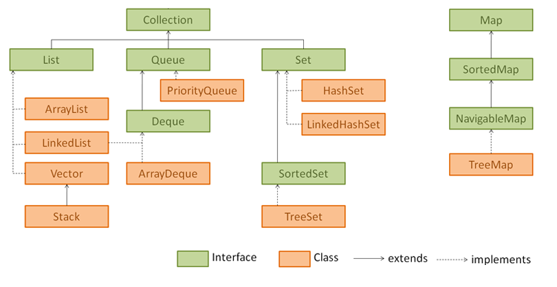
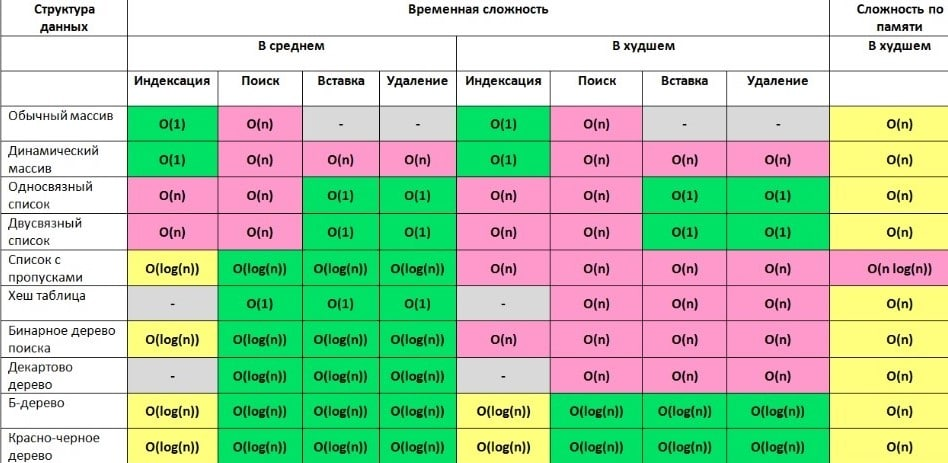

# Коллекции и структуры данных

[← Оглавление](README.md) · Потокобезопасные коллекции — в [concurrency.md](concurrency.md#7-потокобезопасные-коллекции) · Алгоритмы — в [algorithms.md](algorithms.md)

## 1. Иерархия



- `Iterable` → `Collection` → `List`, `Set`, `Queue`/`Deque`.
- **`Map` не наследует `Collection`:** коллекция — набор отдельных элементов (`add(E)`), а map — набор пар ключ–значение (`put(K, V)`). Методы `Collection` для пар не подходят. Зато map даёт представления-коллекции: `keySet()`, `values()`, `entrySet()`.
- `Iterator` — обход с возможностью безопасно удалить текущий элемент (`iterator.remove()`). `ListIterator` — ещё и в обе стороны, с `set`/`add`.
- С Java 21 — `SequencedCollection` / `SequencedMap`: единые `getFirst()`, `getLast()`, `addFirst()`, `reversed()` для `List`, `Deque`, `LinkedHashSet`, `LinkedHashMap`, `TreeMap`.

## 2. Сложность основных операций

| Коллекция | get по индексу | поиск (contains) | вставка/удаление в начале | в конце | в середине (по итератору) |
|---|---|---|---|---|---|
| `ArrayList` | O(1) | O(n) | O(n) | O(1) амортизированно | O(n) |
| `LinkedList` | O(n) | O(n) | O(1) | O(1) | O(1), но дойти до места — O(n) |
| `ArrayDeque` | — | O(n) | O(1) | O(1) | — |

| Коллекция | add / remove / contains | Порядок обхода |
|---|---|---|
| `HashSet` / `HashMap` | O(1) в среднем, O(log n) в худшем (Java 8+, дерево в бакете) | не гарантирован |
| `LinkedHashSet` / `LinkedHashMap` | O(1) | порядок вставки (или доступа) |
| `TreeSet` / `TreeMap` | O(log n) | отсортированный |
| `PriorityQueue` | `offer`/`poll` O(log n), `peek` O(1) | по приоритету (куча) |



## 3. `ArrayList` vs `LinkedList`

- **`ArrayList`** — на массиве. Быстрый доступ по индексу, данные лежат подряд в памяти (дружелюбно к кэшу процессора). При заполнении создаётся новый массив **в 1,5 раза больше** и элементы копируются. Начальная ёмкость — 10 (массив выделяется при первом добавлении).
- **`LinkedList`** — двусвязный список. Каждый элемент — отдельный узел с двумя ссылками (в несколько раз больше памяти), узлы разбросаны по куче.
- **На практике почти всегда `ArrayList`.** Даже вставка в середину у него часто быстрее за счёт `System.arraycopy` и кэша процессора, а у `LinkedList` уходит время на то, чтобы дойти до нужного узла. Для очереди/стека — `ArrayDeque`, а не `LinkedList` и не `Stack` (устарел, синхронизирован).
- **Изменится ли размер `ArrayList` при удалении?** `size()` уменьшится, а **ёмкость внутреннего массива — нет**. Освободить лишнее — `trimToSize()`.
- Удаление по индексу и по значению: у `List<Integer>` `list.remove(1)` удалит элемент **с индексом 1**, а `list.remove(Integer.valueOf(1))` — элемент со **значением** 1.

## 4. Как устроена `HashMap`

**Коротко:** массив бакетов; номер бакета вычисляется из хэша ключа; в бакете — связный список, а при большом числе коллизий — красно-чёрное дерево. При заполнении на 75% массив удваивается.

Пошагово для `put(key, value)`:

1. Считается `hash = key.hashCode() ^ (key.hashCode() >>> 16)` — старшие биты «подмешиваются» к младшим, чтобы хэши, различающиеся только старшими битами, не попали в один бакет.
2. Индекс бакета: `index = hash & (n - 1)`, где `n` — длина массива (всегда степень двойки, поэтому `& (n-1)` равно остатку от деления, но быстрее). Это **побитовое И**, а не умножение.
3. Бакет пуст — кладём новый узел.
4. Бакет не пуст — идём по узлам: если найден ключ с тем же хэшем и `equals() == true`, **заменяем значение** (старое возвращается из `put`). Иначе добавляем узел в конец списка.
5. Если в одном бакете стало **8** узлов и длина массива **не меньше 64**, список превращается в **красно-чёрное дерево** (поиск O(log n) вместо O(n)). Если массив меньше 64 — вместо этого массив расширяется. Когда в дереве остаётся 6 узлов и меньше — обратно в список.
6. Если `size > capacity × loadFactor` (по умолчанию `16 × 0.75 = 12`), массив **удваивается** (resize) и все узлы перераспределяются: каждый остаётся в бакете с тем же индексом или переезжает в `index + старая_длина`.

Ещё детали:
- Параметры конструктора: `initialCapacity` (по умолчанию 16, округляется вверх до степени двойки) и `loadFactor` (0.75). Если заранее известно число элементов, задайте ёмкость, чтобы избежать resize — в Java 19+ есть `HashMap.newHashMap(expectedSize)`, который сам учтёт load factor.
- Массив выделяется лениво — при первом `put`.
- **Ключ `null` разрешён** (один), он всегда в бакете 0. `null`-значения тоже можно. (`Hashtable`, `ConcurrentHashMap` — не допускают.)
- Не потокобезопасна. Параллельная запись может потерять данные (а в Java 7 при resize — даже зациклить список). Для потоков — `ConcurrentHashMap`.

### Вопросы-подвохи по `HashMap`

- **Все ключи с одинаковым `hashCode` — будет работать?** Да, корректно, но все попадут в один бакет. До Java 8 — список, поиск O(n). С Java 8 — дерево, O(log n) (для дерева удобно, если ключи `Comparable`).
- **Можно ли не найти значение по ключу, который точно клали?** Да: (1) ключ — изменяемый объект, и после `put` изменили поле, участвующее в `hashCode`, — ищем не в том бакете; (2) у ключа переопределён `equals`, но не `hashCode` (или наоборот); (3) значение по ключу само `null` — `get` вернёт `null`, отличить помогает `containsKey`.
- **Ключ без переопределённых `equals`/`hashCode`?** Работает, но сравнение по **ссылке**: найти значение можно только тем же самым объектом, а «равный» новый объект не найдёт.
- **Почему ключи лучше делать неизменяемыми?** `String`, `Integer`, `record`, enum — хэш не изменится после вставки.

## 5. Другие реализации `Map`

- **`LinkedHashMap`** — `HashMap` + двусвязный список записей: обход в порядке вставки. С `accessOrder = true` — в порядке доступа; переопределив `removeEldestEntry`, получаем простой **LRU-кэш**:

```java
class LruCache<K, V> extends LinkedHashMap<K, V> {
    private final int capacity;
    LruCache(int capacity) { super(16, 0.75f, true); this.capacity = capacity; }
    @Override protected boolean removeEldestEntry(Map.Entry<K, V> eldest) { return size() > capacity; }
}
```

- **`TreeMap`** — красно-чёрное дерево, ключи отсортированы (по `Comparable` или переданному `Comparator`). Операции O(log n). Есть навигация: `firstKey`, `floorKey`, `ceilingKey`, `headMap`, `subMap`. `null`-ключ нельзя (при естественном порядке). Важно: уникальность ключей определяется **компаратором** (`compareTo == 0`), а не `equals`.
- **`EnumMap`** — для ключей-enum, внутри массив, очень быстрая.
- **`WeakHashMap`** — **ключи** хранятся через слабые ссылки (`WeakReference`), а **значения — обычными (сильными) ссылками**. Когда на ключ не остаётся сильных ссылок снаружи, при ближайшей сборке мусора запись удаляется. Подвох: если значение ссылается на свой ключ, ключ никогда не станет слабодостижимым и запись не удалится. Не синхронизирована. Применение — привязать метаданные к объектам, не продлевая их жизнь.
- **`IdentityHashMap`** — сравнивает ключи по `==`, а не `equals`.
- **`ConcurrentHashMap`** — см. [concurrency.md](concurrency.md#как-устроен-concurrenthashmap-java-8).

## 6. `Set`

`HashSet` внутри — это `HashMap`, где элементы — ключи, а значение — общая заглушка. `LinkedHashSet` — на `LinkedHashMap`, `TreeSet` — на `TreeMap`. Поэтому всё сказанное про `equals`/`hashCode` и про компаратор относится и к ним.

## 7. Fail-fast и fail-safe итераторы

- **Fail-fast** (`ArrayList`, `HashMap`) — у коллекции есть счётчик изменений `modCount`. Если коллекцию изменили не через этот итератор, следующий `next()` бросит `ConcurrentModificationException`. Работает и в одном потоке:

```java
for (String s : list) {
    if (s.isEmpty()) list.remove(s);   // ConcurrentModificationException
}
list.removeIf(String::isEmpty);        // правильно
```

- **Weakly consistent / fail-safe** (`ConcurrentHashMap`, `CopyOnWriteArrayList`) — не бросают исключение: обходят снимок или текущее состояние.

## 8. `Comparable` и `Comparator`

- `Comparable<T>` — «естественный порядок» внутри класса: `compareTo(T other)` (отрицательное, 0, положительное).
- `Comparator<T>` — внешний порядок, можно сколько угодно: `Comparator.comparing(Employee::department).thenComparing(Employee::salary, Comparator.reverseOrder())`.
- `compareTo` должен быть согласован с `equals`, иначе `TreeSet` и `HashSet` поведут себя по-разному.
- Не сравнивать вычитанием (`a - b`) — переполнение `int`. Использовать `Integer.compare(a, b)`.

## 9. Неизменяемые коллекции

- `List.of`, `Set.of`, `Map.of` (Java 9), `List.copyOf` (10), `stream.toList()` (16) — неизменяемые, `null` не допускают (`Set.of` и `Map.of` ещё и бросают исключение на дубликатах).
- `Collections.unmodifiableList(list)` — неизменяемое **представление**: изменения исходного списка будут видны.
- Возвращать из методов неизменяемые коллекции или копии — хорошая защита инвариантов класса.

## 10. Структуры данных — база

- **Массив** — непрерывный блок памяти, доступ по индексу O(1), размер фиксирован.
- **Динамический массив** (`ArrayList`) — массив, который при заполнении пересоздаётся большего размера. Добавление в конец — O(1) амортизированно (дорогие копирования редки).
- **Связный список** — узлы со ссылками на следующий (и предыдущий — в двусвязном). Вставка/удаление при известном узле O(1), доступ по индексу O(n).
- **Стек** (LIFO) и **очередь** (FIFO) — в Java обе через `ArrayDeque` (`push/pop` и `offer/poll`).
- **Хэш-таблица** — см. `HashMap`.
- **Двоичное дерево поиска (BST)** — у каждого узла слева меньшие ключи, справа большие. Поиск, вставка, удаление — O(высота). Если вставлять уже отсортированные данные, дерево **вырождается в цепочку** (по сути связный список), и операции становятся O(n). Поэтому на практике используют **сбалансированные** деревья.
- **Красно-чёрное дерево** — самобалансирующееся BST. Правила: каждый узел красный или чёрный; корень чёрный; листья (null-узлы) чёрные; у красного узла оба потомка чёрные; на любом пути от узла до листьев одинаковое число чёрных узлов. Отсюда самый длинный путь не более чем вдвое длиннее самого короткого, и высота — O(log n). При нарушении правил после вставки/удаления — перекраска и повороты. Используется в `TreeMap` и в бакетах `HashMap`.
- **B-дерево** (B+-дерево) — сильно ветвящееся сбалансированное дерево: в узле много ключей (узел — страница диска), поэтому высота маленькая (3–4 уровня на миллионы записей) и мало обращений к диску. В B+-дереве данные только в листьях, листья связаны в список — удобно для диапазонов. Основа индексов БД ([databases.md](databases.md#5-индексы)).
- **Куча (heap)** — дерево, где родитель не больше потомков (min-heap); хранится в массиве. Минимум — O(1), вставка и извлечение — O(log n). `PriorityQueue`.
- **Граф** — вершины и рёбра; хранят списком смежности или матрицей. Обходы — BFS (очередь, кратчайший путь в невзвешенном графе), DFS (стек/рекурсия).
