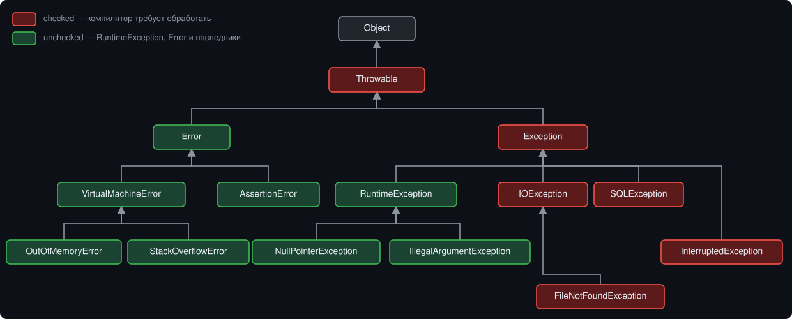

# Java Core

[← Оглавление](README.md) · Коллекции — [collections.md](collections.md) · JVM и GC — [jvm.md](jvm.md) · Многопоточность — [concurrency.md](concurrency.md)

## 1. Методы класса `Object`

`equals()`, `hashCode()`, `toString()`, `getClass()`, `clone()` (protected), `finalize()` (устарел, помечен к удалению — не использовать), `wait()`, `notify()`, `notifyAll()`.

- `toString()` по умолчанию — `ИмяКласса@хэшкод_в_hex`.
- `equals()` по умолчанию — **сравнение ссылок** (`this == obj`).
- `hashCode()` по умолчанию — значение, связанное с объектом (не адрес в памяти напрямую; объекты двигаются GC, а хэш запоминается в заголовке объекта при первом вызове).
- **Класс `Objects`** (не путать с `Object`) — утилиты: `Objects.equals(a, b)` (безопасно к null), `Objects.hash(...)`, `requireNonNull`, `isNull`, `toString(o, default)`.

## 2. `equals()` и `hashCode()`

### Контракт `equals`
- **Рефлексивность:** `x.equals(x) == true`.
- **Симметричность:** `x.equals(y) == y.equals(x)`.
- **Транзитивность:** `x.equals(y)` и `y.equals(z)` ⇒ `x.equals(z)`.
- **Согласованность:** повторные вызовы дают тот же результат, если объекты не менялись.
- `x.equals(null) == false`.

### Контракт между `equals` и `hashCode`
- Если `a.equals(b)`, то **обязательно** `a.hashCode() == b.hashCode()`.
- Обратное не обязано: одинаковый хэш при разных объектах — **коллизия**, это нормально.
- Отсюда: переопределил `equals` — **обязан** переопределить `hashCode`. Иначе равные объекты попадут в разные бакеты `HashMap`/`HashSet`, и `set.contains(equalObject)` вернёт `false`.

`equals()` сам по себе хэшкоды **не сравнивает**. Хэш используют хэш-структуры: `HashMap` сначала по хэшу находит бакет, сравнивает хэши элементов (быстро) и только при совпадении вызывает `equals()`.

### Какие поля брать
- Те же поля, что в `equals`, и **неизменяемые**. Если поле, участвующее в `hashCode`, поменялось после того, как объект положили в `HashSet`, объект «потеряется» — лежит в бакете для старого хэша.
- Не брать производные и ленивые поля, коллекции-ссылки на другие сущности (для JPA — см. [hibernate.md](hibernate.md)).
- Нужно переопределять, только если объект сравнивается по значению (value object, DTO, ключ map). Для сервисов и бинов — не нужно.
- В `record` и Kotlin `data class` `equals`/`hashCode` генерируются автоматически по всем полям.

## 3. Примитивы и обёртки

- 8 примитивов: `byte` (1 байт), `short` (2), `char` (2, без знака), `int` (4), `long` (8), `float` (4), `double` (8), `boolean`.
- Примитив хранит значение; обёртка (`Integer`, `Long`…) — объект в куче, может быть `null`, нужна для коллекций и generics.
- **Где хранятся:** локальная переменная-примитив — на стеке потока; поле-примитив — внутри объекта, то есть в куче. Объекты-обёртки — всегда в куче (если JIT не устранил их через escape analysis).
- **Autoboxing/unboxing** — автоматическое преобразование. Подвох: распаковка `null` → `NullPointerException`: `Integer x = null; int y = x;`.
- **Кэш `Integer`:** `Integer.valueOf()` (и автоупаковка) для значений **от −128 до 127** возвращает закэшированные объекты.

```java
Integer a = 127, b = 127;
a == b;        // true — один объект из кэша
Integer c = 128, d = 128;
c == d;        // false — разные объекты
c.equals(d);   // true — обёртки сравнивать ТОЛЬКО через equals
```

- Деньги — не `double`: `0.1 + 0.2 = 0.30000000000000004`. Использовать `BigDecimal` и создавать его из строки (`new BigDecimal("0.1")`), не из double. Сравнивать — `compareTo`, потому что `new BigDecimal("1.0").equals(new BigDecimal("1.00")) == false` (разный scale).

## 4. `String`

- **Неизменяемый** (`final` класс, внутреннее значение не меняется). Отсюда: потокобезопасен, безопасно использовать ключом map, можно кэшировать хэш, можно хранить в пуле.
- **Пул строк** (String pool) — литералы (`"abc"`) кладутся в пул и переиспользуются. С Java 7 пул находится в куче. `new String("abc")` создаёт новый объект вне пула; `intern()` возвращает объект из пула.

```java
String a = "java";
String b = "java";
String c = new String("java");
a == b;            // true — один объект из пула
a == c;            // false
a == c.intern();   // true
a.equals(c);       // true — строки сравнивать через equals
```

- С Java 9 — **compact strings**: если все символы помещаются в Latin-1, строка хранится как `byte[]` по байту на символ (экономия памяти вдвое).
- Конкатенация `+` в цикле создаёт много промежуточных объектов — используйте `StringBuilder` (не потокобезопасный, быстрый). `StringBuffer` — синхронизированный, устарел по сути. Простое `a + b + c` в одном выражении компилятор оптимизирует сам (с Java 9 через `invokedynamic`).
- Полезное из новых версий: `isBlank()`, `strip()`, `lines()`, `repeat()` (11), text blocks `"""..."""` (15), `formatted()` (15).

## 5. Исключения



- **`Throwable`** → **`Error`** (сбои JVM: `OutOfMemoryError`, `StackOverflowError` — приложение обычно не может их исправить) и **`Exception`**.
- **Проверяемые (checked)** — наследники `Exception`, кроме `RuntimeException`. Компилятор требует обработать или объявить в `throws`. Пример: `IOException`, `SQLException`.
- **Непроверяемые (unchecked)** — `RuntimeException` и наследники (`NullPointerException`, `IllegalArgumentException`, `IllegalStateException`), а также `Error`.
- Чтобы своё исключение было проверяемым, наследуемся от **`Exception`**; непроверяемым — от **`RuntimeException`**.
- В современном коде (Spring, Kotlin) предпочитают непроверяемые: в Kotlin проверяемых исключений нет вообще; Spring `@Transactional` по умолчанию откатывает транзакцию только на unchecked.

### Обработка

```java
try {
    // ...
} catch (IOException | SQLException e) {     // multi-catch (Java 7)
    throw new ServiceException("Не удалось загрузить", e);   // заворачиваем, СОХРАНЯЯ причину
} finally {
    // выполнится почти всегда
}
```

- **`finally` выполнится**, даже если в `try` есть `return` или исключение. **Не выполнится**, если: `System.exit()`; JVM аварийно упала или её убили (`kill -9`); поток-демон, а JVM завершилась; бесконечный цикл или deadlock в `try`.
- `return` в `finally` перекрывает `return` и **проглатывает исключение** из `try` — так делать нельзя.
- **try-with-resources** — для объектов `AutoCloseable` (`InputStream`, `Connection`). Ресурсы закрываются автоматически в обратном порядке. Если упали и `try`, и `close()`, основное исключение — из `try`, а из `close()` добавляется в `getSuppressed()`.
- **Ловить ли `RuntimeException`?** Можно, но ловить стоит то, что можно осмысленно обработать. Ловить `Exception` целиком допустимо на границе (глобальный обработчик в контроллере, верхний уровень воркера).
- **Ловить ли `Error`?** Как правило, нет. `OutOfMemoryError` после поимки оставляет JVM в непредсказуемом состоянии; правильнее дать приложению упасть и перезапуститься (`-XX:+ExitOnOutOfMemoryError`, `HeapDumpOnOutOfMemoryError` для разбора).
- Плохая практика: пустой `catch`, `e.printStackTrace()` вместо логгера, потеря причины (`throw new X(e.getMessage())` без `e`), исключения для управления обычной логикой.

## 6. Интерфейс и абстрактный класс

**Коротко:** интерфейс — контракт «что умеет» без состояния; абстрактный класс — общая основа для близких классов, с состоянием и конструктором. Класс может реализовать много интерфейсов, но наследовать только один класс.

| | Интерфейс | Абстрактный класс |
|---|---|---|
| Поля | только `public static final` константы | любые, с состоянием |
| Конструктор | нет | есть (вызывается из наследника через `super`) |
| Методы | абстрактные, `default` (8), `static` (8), `private` (9) | любые |
| Множественность | класс реализует сколько угодно | наследуется только один |
| Модификаторы методов | `public` (или `private`) | любые |
| Когда | роль, способность, которая может быть у несвязанных классов (`Comparable`, `Flyable`) | общий код и состояние для семейства близких классов (шаблонный метод) |

- Создать экземпляр абстрактного класса напрямую нельзя, но можно создать **анонимный наследник**: `new AbstractFoo() { ... }` — это не экземпляр самого абстрактного класса.
- **`default`-методы** появились в Java 8, чтобы добавлять методы в существующие интерфейсы (например, `Collection.stream()`), не ломая все реализации. Если класс реализует два интерфейса с одинаковым `default`-методом, он обязан переопределить его и может выбрать реализацию: `Vehicle.super.turnAlarmOn()`.
- Если бы в Java не было множественной реализации интерфейсов, пришлось бы делать «толстые» интерфейсы, нарушая принцип разделения интерфейсов (ISP), или дублировать код.

### Функциональный интерфейс

Интерфейс с **ровно одним абстрактным методом** (default- и static-методов может быть сколько угодно). Его можно реализовать лямбдой или ссылкой на метод. Аннотация `@FunctionalInterface` не обязательна — она просит компилятор проверить, что метод один.

Сами такие интерфейсы были и раньше (`Runnable`, `Comparator`, `Callable`), в Java 8 появились лямбды и пакет `java.util.function`:

| Интерфейс | Метод | Смысл |
|---|---|---|
| `Supplier<T>` | `T get()` | дать значение |
| `Consumer<T>` | `void accept(T)` | потребить значение |
| `Function<T, R>` | `R apply(T)` | преобразовать |
| `Predicate<T>` | `boolean test(T)` | проверить условие |
| `UnaryOperator<T>` / `BinaryOperator<T>` | `T apply(T)` / `T apply(T, T)` | операция над одним типом |
| `BiFunction`, `BiConsumer`, `BiPredicate` | — | версии с двумя аргументами |

**Effectively final:** лямбда может использовать локальную переменную, только если она не меняется после инициализации (явно `final` или фактически). `int x = 5; list.forEach(e -> System.out.println(x));` — работает. Если ниже написать `x++` — ошибка компиляции. Причина: лямбда захватывает **копию** значения (локальная переменная живёт на стеке и может исчезнуть раньше лямбды), а изменяемая копия привела бы к путанице и гонкам.

## 7. Перегрузка и переопределение

- **Перегрузка (overloading)** — методы с одним именем и **разными параметрами** в одном классе. Выбирается при **компиляции** по типам аргументов. Возвращаемый тип или модификатор доступа сами по себе перегрузку не создают — только список параметров.
- **Переопределение (overriding)** — наследник даёт свою реализацию метода родителя с **той же сигнатурой**. Выбирается **во время выполнения** по реальному типу объекта (полиморфизм). Правила: модификатор доступа можно **расширить, но не сузить** (`protected` → `public` можно); возвращаемый тип — тот же или подтип (ковариантность); проверяемые исключения — те же, более узкие или никаких.
- **`static`-методы можно перегрузить, но нельзя переопределить.** Метод с той же сигнатурой в наследнике **скрывает** (hiding) родительский; какой вызовется, решается по типу ссылки при компиляции, а не по объекту.
- `private` и `final` методы переопределить нельзя.

## 8. Generics

- Обобщённые типы проверяются **при компиляции**, а в байткоде стираются (**type erasure**): `List<String>` и `List<Integer>` во время выполнения — один класс `List`. Параметр типа заменяется на свою границу: `T` → `Object`, `T extends Number` → `Number`. Сделано ради обратной совместимости с кодом до Java 5.
- Следствия: нельзя `new T()`, `new T[]`, `instanceof List<String>`; нельзя перегрузить методы `m(List<String>)` и `m(List<Integer>)`; примитивы как параметры нельзя (`List<int>`).
- **Wildcards и PECS** (Producer Extends, Consumer Super):
  - `List<? extends Number>` — можно **читать** как `Number`, нельзя добавлять (кроме `null`): список может оказаться `List<Integer>`.
  - `List<? super Integer>` — можно **добавлять** `Integer`, читать только как `Object`.
  - Пример: `Collections.copy(List<? super T> dest, List<? extends T> src)`.
- **Инвариантность:** `List<Integer>` **не** является подтипом `List<Number>` (иначе в него можно было бы положить `Double`). Массивы — ковариантны (`Integer[]` подтип `Number[]`), за это расплачиваются `ArrayStoreException` во время выполнения.

## 9. Ссылки: strong, soft, weak, phantom

| Тип | Когда объект соберёт GC | Для чего |
|---|---|---|
| Strong (обычная) | никогда, пока есть ссылка | всё |
| `SoftReference` | при нехватке памяти (перед `OutOfMemoryError`) | кэши, чувствительные к памяти |
| `WeakReference` | при ближайшей сборке, если нет сильных ссылок | `WeakHashMap`, канонизирующие map, слушатели |
| `PhantomReference` | после того, как объект признан мёртвым; `get()` всегда `null` | очистка нативных ресурсов (`Cleaner`) вместо `finalize()` |

## 10. `public static void main(String[] args)`

- Точка входа, которую ищет JVM при запуске класса.
- `public` — чтобы JVM могла вызвать метод извне класса; `static` — вызывается без создания объекта; `void` — JVM не ждёт результата (код возврата задаётся через `System.exit(code)`); `String[] args` — аргументы командной строки.
- Если подходящего метода нет, запуск завершится сообщением `Error: Main method not found in class ...`.
- **С Java 25** (JEP 512) можно писать короче: `void main() { IO.println("Hello"); }` — метод может быть нестатическим и без параметров, а для простых программ можно не объявлять класс вовсе (compact source file). JVM создаст экземпляр класса сама. Это сделано для обучения и скриптов.

## 11. Stream API

**Коротко:** декларативная обработка последовательностей: источник → цепочка **промежуточных** операций (ленивые, возвращают `Stream`) → одна **терминальная** операция (запускает вычисление). Стрим одноразовый.

```java
Map<String, Long> countByDept = employees.stream()
        .filter(e -> e.salary() > 100_000)           // промежуточная
        .map(Employee::department)                   // промежуточная
        .collect(Collectors.groupingBy(d -> d, Collectors.counting()));   // терминальная
```

- **Ленивость:** пока нет терминальной операции, ничего не выполняется. Элементы проходят по цепочке по одному (не «сначала весь filter, потом весь map»), поэтому `findFirst` после `filter` остановится на первом подходящем.
- **`map`** — преобразует каждый элемент в один новый (1 → 1).
- **`flatMap`** — каждый элемент превращается в **стрим** элементов, и все они склеиваются в один (1 → 0..N). Пример: список заказов → стрим всех позиций всех заказов: `orders.stream().flatMap(o -> o.items().stream())`. Ещё — развернуть `Optional` или вложенные списки.
- **`filter`** — оставляет элементы по условию. «Недостатки» `filter`, о которых спрашивают: он не меняет размер источника и проходит все элементы; несколько `filter` подряд читаются хуже одного; побочные эффекты внутри предиката — плохо.
- Промежуточные: `filter`, `map`, `flatMap`, `distinct`, `sorted`, `peek` (для отладки), `limit`, `skip`, `takeWhile`/`dropWhile` (9), `mapMulti` (16).
- Терминальные: `collect`, `toList()` (16, возвращает **неизменяемый** список), `forEach`, `reduce`, `count`, `min`/`max`, `anyMatch`/`allMatch`/`noneMatch`, `findFirst`/`findAny`.
- Collectors: `toList`, `toSet`, `toMap` (бросит `IllegalStateException` на дубликате ключа — передайте merge-функцию), `groupingBy`, `partitioningBy`, `joining`, `counting`, `summingInt`, `averagingDouble`.
- **Stream Gatherers** (Java 24, `Stream.gather`) — свои промежуточные операции, например окна: `stream.gather(Gatherers.windowFixed(3))`.
- Примитивные стримы `IntStream`, `LongStream` — без упаковки: `mapToInt(...).sum()`.
- Параллельные стримы — см. вопрос 8 в [concurrency.md](concurrency.md#13-задачи-и-вопросы-ловушки).
- Не менять источник во время обработки и не использовать побочные эффекты (запись во внешний список из `forEach` в параллельном стриме — гонка).

## 12. `Optional`

- Контейнер «значение или ничего» для **возвращаемых значений** методов, чтобы явно показать, что результата может не быть.
- Использовать: `map`, `flatMap`, `filter`, `orElse`, `orElseGet` (ленивый — функция вызовется, только если пусто), `orElseThrow`, `ifPresentOrElse`.
- Подвох: `orElse(createDefault())` вызывает `createDefault()` **всегда**, даже если значение есть. Для дорогих значений — `orElseGet`.
- Не использовать для полей, параметров методов и коллекций (пустая коллекция вместо `Optional<List>`). `Optional.get()` без проверки — тот же NPE, только иначе названный.

## 13. Современная Java (17 → 21 → 25)

Актуальные LTS-версии — **17, 21 и 25**. Senior-разработчику стоит уметь рассказать, что нового и чем пользовался.

| Возможность | Версия | Суть |
|---|---|---|
| `var` | 10 | вывод типа локальной переменной |
| `switch`-выражения | 14 | `case A, B -> value;`, возвращает значение, без `break` |
| Text blocks | 15 | многострочные строки `"""` |
| **`record`** | 16 | неизменяемый класс-носитель данных |
| `instanceof` с шаблоном | 16 | `if (o instanceof String s) s.length()` |
| **`sealed`-классы** | 17 | закрытый список наследников: `sealed interface Shape permits Circle, Square` |
| **Pattern matching в `switch`** | 21 | `switch (shape) { case Circle c -> ...; case Square s -> ...; }` — компилятор проверяет полноту для sealed |
| Record patterns | 21 | деконструкция: `case Point(int x, int y) ->` |
| **Виртуальные потоки** | 21 | см. [concurrency.md](concurrency.md#10-виртуальные-потоки-java-21) |
| Sequenced collections | 21 | `getFirst()`, `getLast()`, `reversed()` у `List`, `Deque`, `LinkedHashMap`… |
| Безымянные переменные `_` | 22 | `catch (Exception _)`, `case Point(var x, _)` |
| Stream Gatherers | 24 | свои промежуточные операции стрима |
| `synchronized` без pinning виртуальных потоков | 24 | JEP 491 |
| Scoped Values | 25 | замена `ThreadLocal` для виртуальных потоков |
| Компактный `main`, `import module` | 25 | короткие программы и скрипты |
| Гибкие тела конструкторов | 25 | код (проверки аргументов) до `super(...)` |
| Compact object headers | 25 | заголовок объекта меньше → экономия памяти (включается флагом) |

### `record`

```java
public record Money(BigDecimal amount, String currency) {
    public Money {                                   // компактный конструктор — для проверок
        Objects.requireNonNull(amount);
        if (amount.signum() < 0) throw new IllegalArgumentException("Отрицательная сумма");
    }
    public Money plus(Money other) { return new Money(amount.add(other.amount), currency); }
}
```

- Класс `final`, поля `private final`, генерируются конструктор, аксессоры `amount()` (без `get`), `equals`, `hashCode`, `toString`.
- Нельзя наследоваться от другого класса (неявно наследует `java.lang.Record`), но можно реализовывать интерфейсы, добавлять методы и статические поля.
- Неизменяемость «поверхностная»: если поле — `List`, сам список можно изменить. Копировать в компактном конструкторе: `items = List.copyOf(items)`.
- **Где хороши:** DTO, ответы API, значения (value objects), ключи map, проекции Spring Data, события. Jackson и Spring их поддерживают.
- **Почему не JPA-сущность:** Hibernate нужен конструктор без аргументов, изменяемые поля (dirty checking) и возможность создавать прокси-наследника для ленивой загрузки; record — `final` и неизменяемый. Для Spring Data JDBC record подходит.

## 14. Сериализация

- **Сериализация** — превращение объекта в последовательность байт или текст (JSON, Avro, Protobuf) для передачи по сети или сохранения; **десериализация** — обратно.
- Встроенная Java-сериализация (`Serializable`, `ObjectOutputStream`) — устаревший подход: медленная, хрупкая к изменениям классов (`serialVersionUID`) и **опасная** — десериализация недоверенных данных приводила к удалённому выполнению кода. Сейчас для обмена — JSON (Jackson), Avro, Protobuf.
- `transient` — поле не сериализуется.

## 15. Короткие ответы на частые вопросы

- **`==` vs `equals`?** Ссылки против содержимого (если `equals` переопределён).
- **Можно ли переопределить `static`-метод?** Нет, только скрыть. Перегрузить — можно.
- **`final` / `finally` / `finalize`?** Модификатор (нельзя изменить/переопределить/унаследовать) / блок, выполняемый всегда / устаревший метод перед сборкой объекта.
- **Почему `String` неизменяемый?** Безопасность (ключи, пароли, пути), пул строк, кэш хэша, потокобезопасность.
- **Как преобразовать массив в `ArrayList`?** `new ArrayList<>(Arrays.asList(arr))` или `new ArrayList<>(List.of(arr))`. Сам `Arrays.asList` возвращает список **фиксированного размера**, связанный с массивом (`add` → `UnsupportedOperationException`, `set` меняет массив).
- **`List.of()` vs `Arrays.asList()` vs `Collections.unmodifiableList()`?** `List.of` — полностью неизменяемый, не допускает `null`. `Arrays.asList` — фиксированный размер, `set` можно. `unmodifiableList` — неизменяемое **представление** поверх исходного списка: исходный поменяют — изменится и он.
- **`List.of()` нарушает LSP?** Формально `add()` бросает `UnsupportedOperationException`, хотя интерфейс `List` его объявляет. Это известный компромисс дизайна коллекций Java: «необязательные операции» описаны в документации `Collection`.
