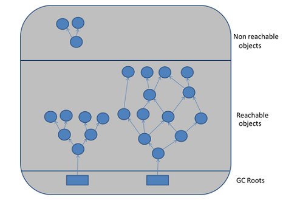

# JVM: память, сборка мусора, загрузка классов

[← Оглавление](README.md) · Модель памяти Java (happens-before, volatile) — в [concurrency.md](concurrency.md#2-java-memory-model-jmm-и-happens-before)

## 1. Области памяти JVM

**Коротко:** куча (heap) — общая для всех потоков, там все объекты, её чистит GC. Стек — у каждого потока свой, там кадры вызовов методов с локальными переменными. Metaspace и Code Cache — вне кучи, в нативной памяти.

| Область | Чья | Что хранит | Ошибка при переполнении |
|---|---|---|---|
| **Heap (куча)** | общая | все объекты и массивы, пул строк (с Java 7) | `OutOfMemoryError: Java heap space` |
| **Stack (стек потока)** | у каждого потока | кадры методов: локальные переменные (примитивы и **ссылки** на объекты), параметры, промежуточные результаты | `StackOverflowError` (обычно бесконечная рекурсия) |
| **Metaspace** | общая, **нативная память** | метаданные классов: структура классов, методы, байткод, константы | `OutOfMemoryError: Metaspace` (утечка загрузчиков классов) |
| **Code Cache** | общая, нативная | машинный код, скомпилированный JIT | JIT перестаёт компилировать, всё замедляется |
| PC register, native method stack | у потока | адрес текущей инструкции, стек нативных вызовов | — |

- **Metaspace** заменил PermGen в Java 8. Он в нативной памяти и по умолчанию **не ограничен** (растёт, пока есть память у ОС), поэтому `OutOfMemoryError: PermGen` больше нет, но `OutOfMemoryError: Metaspace` бывает. Ограничение — `-XX:MaxMetaspaceSize`. Метаданные класса освобождаются, когда собран его загрузчик классов.
- Ещё память вне кучи: direct buffers (`ByteBuffer.allocateDirect`, Netty), стеки потоков, сам GC. Поэтому **процесс JVM всегда занимает больше, чем `-Xmx`** — важно для лимитов в Kubernetes.

### Поколения в куче

Гипотеза поколений: **большинство объектов умирают молодыми** (временные объекты внутри метода). Поэтому куча делится:
- **Young generation** — **Eden** (здесь создаются новые объекты) + два **Survivor** (S0, S1). Сборка молодого поколения (minor GC) — частая и быстрая: живые объекты из Eden и одного Survivor копируются во второй Survivor, всё остальное считается свободным.
- **Old generation (tenured)** — объекты, пережившие несколько minor GC (порог возраста), переносятся сюда. Сборка старого поколения (major/full GC) — реже и дороже.
- В G1 куча поделена не на две непрерывные части, а на множество одинаковых **регионов**, и каждый регион играет роль Eden, Survivor или Old.

### Параметры

- `-Xms` — начальный размер кучи, `-Xmx` — максимальный (`-Xmx4g`). На сервере их часто ставят равными, чтобы куча не меняла размер.
- `-Xss` — размер стека потока.
- **В контейнере** JVM (с Java 10) видит лимиты cgroup. Удобнее задавать долю: `-XX:MaxRAMPercentage=75` — куча займёт 75% лимита памяти контейнера, остальное — на metaspace, стеки и нативную память. Без этого по умолчанию куча — лишь 25% памяти.

## 2. Сборка мусора (GC)

### Как GC понимает, что объект — мусор

- **Подсчёт ссылок (reference counting)** — у объекта счётчик ссылок, 0 — мусор. Не умеет циклы (A ссылается на B, B на A, а снаружи никто). **В JVM не используется.**
- **Трассировка (tracing / reachability)** — используется в JVM: от **GC roots** обходятся все достижимые по ссылкам объекты и помечаются живыми. Всё недостижимое — мусор, даже если объекты ссылаются друг на друга по кругу.

### GC roots — откуда начинается обход

- Локальные переменные и параметры в стеках **всех живых потоков** (не только `main`).
- Статические поля загруженных классов.
- Ссылки из нативного кода (JNI).
- Объекты, используемые как мониторы (`synchronized`).
- Сами живые потоки (`Thread`) и системные объекты JVM.

### Основные шаги

1. **Mark** — пометить достижимые объекты.
2. **Sweep** — освободить память недостижимых.
3. **Compact** — сдвинуть живые объекты, чтобы убрать фрагментацию. Либо **copy** — скопировать живые в другую область (так работает молодое поколение).

**Stop-the-world (STW)** — пауза, когда все потоки приложения остановлены ради GC. Современные сборщики делают основную работу **параллельно с приложением** (concurrent) и сокращают паузы.

### Какие сборщики есть

| Сборщик | Суть | Когда |
|---|---|---|
| **Serial** | один поток, всё STW | маленькие кучи, один CPU, утилиты |
| **Parallel** | много потоков, всё STW, максимум пропускной способности | пакетная обработка, где паузы не важны |
| **G1** (Garbage First) | **по умолчанию с Java 9**. Регионы; собирает в первую очередь регионы с наибольшим количеством мусора; цель по паузе (`-XX:MaxGCPauseMillis`, по умолчанию 200 мс) | универсальный выбор для большинства сервисов |
| **ZGC** | почти всё параллельно, паузы < 1 мс независимо от размера кучи (до терабайт). Generational ZGC — с Java 21, по умолчанию в режиме поколений с Java 23 | низкая задержка, большие кучи |
| **Shenandoah** | как ZGC, параллельное уплотнение; режим с поколениями — с Java 25 | низкая задержка |
| Epsilon | ничего не собирает | тесты производительности, очень короткие задачи |
| ~~CMS~~ | устарел в Java 9, **удалён в Java 14** | — |

Выбор: `-XX:+UseG1GC`, `-XX:+UseZGC`, `-XX:+UseShenandoahGC`. Важно: в контейнере с 1 CPU и маленькой памятью JVM может сама выбрать Serial GC.

### Как искать проблемы с памятью

- Логи GC: `-Xlog:gc*` — частота и длительность пауз.
- Heap dump: `-XX:+HeapDumpOnOutOfMemoryError` или `jcmd <pid> GC.heap_dump file.hprof`; анализ — Eclipse MAT, VisualVM, IntelliJ.
- `jcmd`, `jstat -gcutil`, Java Flight Recorder (`jcmd <pid> JFR.start`) + JDK Mission Control.
- Типичные утечки: статические коллекции, которые только растут; кэши без вытеснения; `ThreadLocal` без `remove()` в пулах; незакрытые ресурсы; слушатели, которых не отписали.

## 3. Загрузчики классов (ClassLoader)

**Коротко:** загрузчик находит класс (в jar, в модуле, по сети), читает байткод и создаёт класс в JVM. Загрузка ленивая — при первом обращении к классу. Работает модель **делегирования родителю**.

С Java 9 (модульная система) три встроенных загрузчика:
1. **Bootstrap** — встроен в JVM (написан на C++), загружает базовые модули: `java.base` (`java.lang`, `java.util`…).
2. **Platform** (раньше — Extension) — остальные модули платформы (`java.sql` и др.). Каталог `jre/lib/ext` и `java.ext.dirs` **удалены в Java 9**.
3. **Application (System)** — классы приложения из classpath / module path.

**Делегирование:** прежде чем загрузить класс самому, загрузчик спрашивает родителя. Поэтому свой `java.lang.String` подложить нельзя — его всегда загрузит Bootstrap.

- Класс в JVM определяется **именем + загрузчиком**. Один и тот же класс, загруженный двумя загрузчиками, — два разных класса (`ClassCastException` при приведении между ними). Так работают серверы приложений и горячая перезагрузка.
- Этапы: **loading** (чтение байткода) → **linking** (проверка байткода, подготовка статических полей значениями по умолчанию, разрешение ссылок) → **initialization** (выполнение статических инициализаторов, один раз, потокобезопасно — поэтому работает holder-синглтон).
- Spring Boot fat jar использует свой загрузчик, чтобы читать jar-ы внутри jar.

## 4. JIT-компиляция

- JVM сначала **интерпретирует** байткод, а «горячие» методы (часто вызываемые) компилирует в машинный код. **Tiered compilation:** C1 (быстрая компиляция, простые оптимизации) → C2 (долгая, агрессивные оптимизации по собранной статистике).
- Оптимизации: встраивание методов (inlining), escape analysis (объект не выходит из метода → можно не выделять его в куче), удаление лишних проверок, развёртка циклов.
- Отсюда **прогрев (warm-up)**: первые запросы после старта медленнее. Важно для нагрузочных тестов (сначала прогрев, потом замер) и для автоскейлинга.
- Ускорить старт: **AppCDS** / CDS-архивы (кэш загруженных классов), Project Leyden (AOT-кэш в Java 24–25), **GraalVM Native Image** (компиляция в нативный бинарник заранее: старт за миллисекунды, мало памяти, но долгая сборка и ограничения на рефлексию). Spring Boot поддерживает и CRaC, и native image.

## 5. Короткие ответы

- **Где хранятся объекты, а где ссылки?** Объекты — в куче. Ссылка в локальной переменной — в стеке потока, ссылка в поле — внутри объекта в куче.
- **Какой GC по умолчанию?** G1 (с Java 9).
- **Чем `OutOfMemoryError` отличается от `StackOverflowError`?** Кончилась куча (или metaspace и т. д.) против переполнения стека потока (глубокая рекурсия).
- **Можно ли вызвать GC вручную?** `System.gc()` — только просьба, JVM может проигнорировать. На проде не используют.
- **Что такое stop-the-world?** Остановка всех потоков приложения на время части работы GC.
- **Почему контейнер с JVM убивает OOM killer, хотя `-Xmx` меньше лимита?** Процесс занимает ещё metaspace, стеки потоков, code cache, direct buffers. Оставлять запас, использовать `MaxRAMPercentage`.
