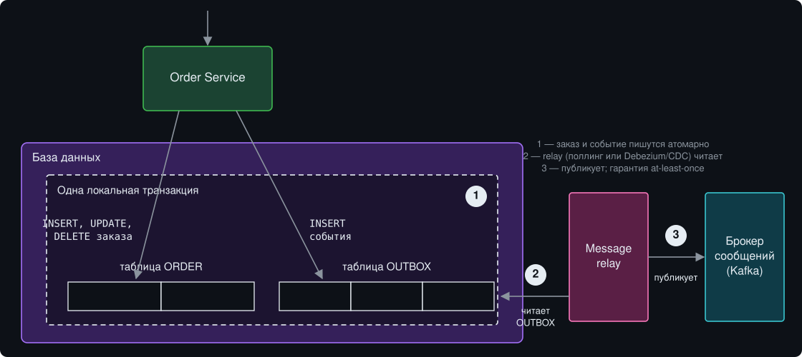

# Микросервисы и распределённые системы

[← Оглавление](README.md) · Kafka — [kafka.md](kafka.md) · Проектирование систем — [system-design.md](system-design.md)

## Монолит, SOA, микросервисы

- **Монолит** — всё приложение одним развёртываемым артефактом. Плюсы: просто разрабатывать на старте, одна транзакция БД, легко отлаживать, нет сетевых вызовов между частями. Минусы при росте: долгая сборка и релиз, всё масштабируется только целиком, одна ошибка (утечка памяти) роняет всё, команды мешают друг другу, трудно менять технологии.
- **SOA** — сервисы общаются через общую шину (ESB), в которой часто живёт логика маршрутизации и преобразования; сервисы крупные, данные нередко общие.
- **Микросервисы** — небольшие сервисы вокруг бизнес-возможностей (bounded context), у каждого **своя БД**, независимый деплой, общение через API или события, «умные сервисы — глупые каналы». Плюсы: независимые релизы и масштабирование, изоляция сбоев, автономия команд. Минусы: распределённые транзакции и согласованность данных, сетевые сбои и задержки, сложная эксплуатация (мониторинг, трассировка, CI/CD для десятков сервисов), сложнее тестировать.
- **Модульный монолит** — один артефакт, но строго разделённые модули с явными границами (Spring Modulith). Часто разумный первый шаг: границы проверяются до того, как платить за распределённость.

**Как распилить монолит** (паттерн **Strangler Fig**, «душитель»): ставим перед монолитом прокси/gateway, выносим одну функциональность в новый сервис и переключаем на него маршрут; повторяем, пока от монолита не останется ничего. Данные выделяем вместе с функциональностью; на переходный период — синхронизация через события или CDC. Начинать с границ, которые реже всего меняются вместе с остальным, и с того, что даёт выигрыш (нагрузка, частота изменений).

## CAP и PACELC

**CAP:** при сетевом разделении (**P**artition — часть узлов не видит другую) распределённая система должна выбрать: **C**onsistency (все узлы отвечают одинаково актуальными данными; при невозможности — ошибка) или **A**vailability (каждый узел отвечает, пусть и устаревшими данными).

- Разделения сети в реальности неизбежны, поэтому выбор на практике — **CP** или **AP** на время сбоя. «CA-систем» в распределённом мире не бывает.
- CP: ZooKeeper, etcd, ведущий PostgreSQL с синхронной репликацией. AP: Cassandra, DynamoDB (по умолчанию), DNS.
- **PACELC** уточняет: если Partition — выбор A или C; **E**lse (в нормальном режиме) — выбор между **L**atency и **C**onsistency. Синхронная репликация согласованна, но медленнее.
- **Eventual consistency (согласованность в конечном счёте)** — данные на разных узлах/сервисах станут одинаковыми **со временем**. Норма для микросервисов, обменивающихся событиями.

## Масштабирование

- **Вертикальное** — мощнее сервер. Просто, но есть предел и единая точка отказа.
- **Горизонтальное** — больше экземпляров за балансировщиком. Требует **stateless** сервисов (состояние — в БД, кэше, брокере). Даёт и отказоустойчивость.
- В Kubernetes — увеличить `replicas` в Deployment вручную или автоматически через **HPA** (Horizontal Pod Autoscaler) по CPU, памяти или своим метрикам (lag в Kafka, RPS).
- Узким местом часто становится БД: реплики для чтения, кэш, партиционирование, шардирование — [databases.md](databases.md#9-масштабирование).

## Как сервисы общаются

| | Синхронно (REST, gRPC) | Асинхронно (Kafka, RabbitMQ) |
|---|---|---|
| Когда | нужен ответ сейчас (проверить баланс, получить данные для экрана) | достаточно сообщить факт или поставить задачу; ответ не нужен сразу |
| Связанность | высокая во времени: вызываемый должен быть жив | низкая: продюсер не знает потребителей, потребитель может быть временно недоступен |
| Сбои | каскадные отказы, нужны таймауты, retry, circuit breaker | сообщение подождёт в брокере; нужны идемпотентность, DLT |
| Согласованность | проще понять | eventual consistency |

Правило: команда, на которую нужен немедленный ответ, — синхронно; уведомление о произошедшем («платёж проведён») — событием.

**Хореография vs оркестрация:** при хореографии сервисы реагируют на события друг друга, центра нет (легко добавить подписчика, трудно увидеть весь процесс). При оркестрации отдельный сервис-оркестратор явно командует шагами (процесс виден в одном месте; инструменты — Camunda, Temporal, Spring State Machine или свой автомат состояний).

## Устойчивость: таймауты, retry, circuit breaker

Ситуация из собеседования: сервис A регулярно вызывает сервис B, B начал отвечать медленно или упал. Потоки A висят в ожидании, пул заканчивается, A тоже перестаёт отвечать — **каскадный отказ**.

Инструменты (в Java — библиотека **Resilience4j**; Hystrix от Netflix с 2018 года не развивается; в Spring Framework 7 часть встроена в ядро — `@Retryable`, `@ConcurrencyLimit`):

1. **Таймаут** — обязателен на каждом внешнем вызове (connect и read). Без него поток ждёт бесконечно.
2. **Retry с экспоненциальной задержкой и jitter** — только для временных ошибок и **идемпотентных** операций. Без jitter все клиенты повторяют одновременно и добивают сервис («retry storm»). Ограничивать число попыток.
3. **Circuit breaker (автоматический выключатель):**
   - **Closed** — вызовы идут, ошибки считаются.
   - Доля ошибок/медленных вызовов превысила порог → **Open** — вызовы сразу отклоняются (быстрый отказ или fallback), B получает передышку.
   - Через время → **Half-open** — пропускаем несколько пробных вызовов: успешны → Closed, нет → снова Open.
4. **Bulkhead (переборка)** — отдельный ограниченный пул/семафор на каждую зависимость: медленный B займёт только свои 10 потоков, а не все.
5. **Rate limiter** — ограничить частоту вызовов (свою нагрузку на чужой сервис или входящую на свой).
6. **Fallback** — запасной ответ: кэшированное значение, значение по умолчанию, деградация функции.

## Transactional outbox



**Проблема (dual write):** нужно сохранить заказ в БД **и** отправить событие в Kafka.

```java
@Transactional
public void create(Order order) {
    orderRepository.save(order);
    kafkaTemplate.send("orders", new OrderCreatedEvent(order));
}
```

Что может пойти не так:
- Событие ушло, а транзакция БД потом откатилась (например, нарушение ограничения при flush в момент коммита) — подписчики узнали о заказе, которого нет.
- БД закоммитилась, а отправка в Kafka упала или приложение упало между шагами — заказ есть, а событие потеряно.
- `@Transactional` охватывает только БД; распределённой транзакции (2PC/XA) между PostgreSQL и Kafka нет, а там, где 2PC возможна, она медленная, держит блокировки и плохо масштабируется.

**Решение:** в **той же локальной транзакции**, что и бизнес-данные, записываем событие в таблицу `outbox`. Атомарность даёт обычная ACID-транзакция: либо и заказ, и событие, либо ничего. Отдельный процесс публикует записи из outbox в брокер.

```sql
create table outbox (
    id             uuid primary key,
    aggregate_type text        not null,   -- 'Order'
    aggregate_id   text        not null,   -- id заказа — пойдёт ключом сообщения (порядок по заказу)
    type           text        not null,   -- 'OrderCreated'
    payload        jsonb       not null,
    created_at     timestamptz not null default now(),
    sent_at        timestamptz
);
```

Как публиковать:
1. **Polling publisher** — по расписанию выбирать неотправленные записи, отправлять, помечать отправленными (или удалять).

```java
@Scheduled(fixedDelay = 1000)
@Transactional
public void publish() {
    // FOR UPDATE SKIP LOCKED — несколько инстансов разбирают разные записи и не мешают друг другу
    List<OutboxRecord> batch = outboxRepository.lockNextBatch(100);
    for (OutboxRecord r : batch) {
        kafkaTemplate.send("orders", r.aggregateId(), r.payload()).join();   // дождаться подтверждения
        r.markSent();
    }
}
```

   На нескольких инстансах нужно исключить двойную обработку одних и тех же записей: `SELECT ... FOR UPDATE SKIP LOCKED` или запуск шедулера только на одном инстансе (**ShedLock**).
2. **Transaction log tailing (CDC)** — **Debezium** читает журнал PostgreSQL (WAL, логическая репликация) и публикует вставки в outbox в Kafka. Меньше задержка, нет нагрузки поллингом, но нужна инфраструктура Kafka Connect.

Свойства:
- Гарантия — **at-least-once**: если упали после отправки, но до пометки `sent_at`, запись уйдёт повторно. Exactly-once здесь сложно и обычно не нужно.
- Поэтому на стороне получателя — **идемпотентный консьюмер** с таблицей **inbox** (обработанные id событий) — см. [kafka.md](kafka.md#6-гарантии-доставки).
- Таблицу outbox чистить (удалять отправленное или партиционировать по дате).

## Saga — распределённые бизнес-транзакции

**Проблема:** бизнес-операция затрагивает несколько сервисов со своими БД (создать заказ → зарезервировать деньги → зарезервировать товар). Одной ACID-транзакции нет.

**Saga** — последовательность локальных транзакций, каждая в своём сервисе. Если шаг не удался, выполняются **компенсирующие транзакции** для уже выполненных шагов (отменить резерв денег, отменить заказ).

- **Хореография** — каждый сервис слушает события и публикует свои: `OrderCreated` → платёжный сервис резервирует → `PaymentReserved` → склад → `StockReserved` / `StockFailed` → платёжный сервис компенсирует.
- **Оркестрация** — оркестратор хранит состояние саги (автомат состояний) и командует участниками. Проще отлаживать и менять процесс.
- Компенсации должны быть **идемпотентными**, а шаги — повторяемыми.
- Нет изоляции: промежуточные состояния видны другим (заказ «в обработке»). Противоядие — семантические блокировки (статус `PENDING`), порядок шагов (сначала то, что легко компенсировать).
- Альтернатива для двух сервисов — **TCC (Try–Confirm–Cancel)**: сначала резерв, потом подтверждение или отмена.

## Идемпотентность API

Клиент отправил `POST /payments`, ответ потерялся по таймауту, клиент повторил — **два платежа**.

Решение — **ключ идемпотентности** (`Idempotency-Key: <uuid>` в заголовке, генерирует клиент):
1. Сервер в транзакции пытается вставить ключ в таблицу (`unique`) вместе с хэшем запроса.
2. Ключ новый → выполняем операцию, сохраняем результат рядом с ключом.
3. Ключ уже есть → не выполняем повторно, возвращаем сохранённый результат (или `409`, если тело запроса отличается, или «в процессе», если первый запрос ещё выполняется).
4. Ключи хранить ограниченное время (TTL).

То же для консьюмеров сообщений — inbox по id события.

## Другие паттерны

- **API Gateway** — единая точка входа для клиентов: маршрутизация, аутентификация, rate limiting, TLS, агрегация. Spring Cloud Gateway, Kong, Nginx. **BFF (Backend for Frontend)** — отдельный gateway под конкретный клиент (веб, мобильное приложение).
- **Service discovery** — как найти адрес сервиса: в Kubernetes — встроенный DNS и `Service`; без него — Eureka, Consul.
- **Централизованная конфигурация** — Spring Cloud Config, Consul, ConfigMap/Secret в Kubernetes, Vault для секретов.
- **Database per service** — у сервиса своя схема/БД, чужие данные — только через API или события. Общая БД между сервисами = скрытая связанность.
- **CQRS** — раздельные модели записи (команды) и чтения (запросы); модель чтения может быть денормализованной витриной, обновляемой событиями.
- **Event Sourcing** — хранить не текущее состояние, а журнал событий, из которого оно вычисляется (состояние счёта = сумма всех операций). Полная история и аудит, но сложнее запросы и эволюция схемы событий.
- **Историчность данных** — помимо основной таблицы хранить таблицу истории (версии записи с периодом действия), запись в обе — в одной транзакции (вручную, триггером или Hibernate Envers); либо event sourcing.
- **Sidecar / service mesh** (Istio, Linkerd) — mTLS, повторы, трассировка выносятся из кода в прокси рядом с сервисом.

## Кэширование

- **Локальный кэш** (Caffeine) — в памяти инстанса, самый быстрый; при нескольких инстансах данные расходятся.
- **Распределённый кэш** (**Redis**) — общий для всех инстансов, сетевой вызов.
- Стратегии:
  - **Cache-aside** (самая частая) — читаем из кэша; промах → читаем из БД и кладём в кэш. При изменении — **удаляем** ключ из кэша (а не обновляем — меньше гонок).
  - Write-through — пишем в кэш и БД синхронно. Write-behind — в кэш сразу, в БД асинхронно (риск потерять).
- Проблемы: **инвалидация** (как узнать, что данные устарели — TTL, события об изменении); **cache stampede** (ключ истёк, тысячи запросов одновременно идут в БД — блокировка на перестроение, «вероятностное» раннее обновление); **холодный старт**; что кэшировать нельзя (балансы для списаний — источник правды только БД).
- Redis кроме кэша: распределённые блокировки (с оговорками), rate limiting, счётчики, сессии (Spring Session), pub/sub, очереди (Streams).
- В Spring — `@Cacheable`, `@CacheEvict`, `@CachePut` + `RedisCacheManager`.

## Наблюдаемость

Три столпа:
1. **Логи** — структурированные (JSON), с уровнем, `traceId` и контекстом; собираются в ELK/OpenSearch или Loki. Не логировать ПДн и секреты.
2. **Метрики** — числовые ряды: RPS, ошибки, задержки (перцентили p95/p99, не среднее!), пулы, lag Kafka, JVM (heap, GC). Micrometer → Prometheus → Grafana, алерты.
3. **Трассировка** — путь одного запроса через все сервисы: `traceId` передаётся в заголовках (W3C `traceparent`) и в сообщениях Kafka. Micrometer Tracing / OpenTelemetry → Jaeger, Tempo, Zipkin.

Методики: **RED** (Rate, Errors, Duration — для сервисов), **USE** (Utilization, Saturation, Errors — для ресурсов). **SLI / SLO / SLA** — измеряемый показатель / целевой уровень («99,9% запросов быстрее 300 мс») / договорное обязательство.

## Вопросы — короткие ответы

- **Как обеспечить согласованность данных между сервисами?** Локальные транзакции + события (outbox) + eventual consistency; для бизнес-операций — Saga с компенсациями; идемпотентные обработчики.
- **Как обеспечить согласованность, когда с одной записью работает много пользователей?** Оптимистичная блокировка (`@Version`, при конфликте — 409 и повтор) или пессимистичная (`SELECT FOR UPDATE`), атомарные SQL-обновления; для очередей операций — сериализация через ключ партиции Kafka.
- **Как хранить сессии, если подов много?** Stateless + JWT или общее хранилище сессий (Redis, Spring Session).
- **Сервис B упал, как защитить A?** Таймауты, circuit breaker, bulkhead, fallback; асинхронное взаимодействие, где возможно.
- **Как сделать, чтобы `@Scheduled` выполнялся на одном поде из пяти?** ShedLock (блокировка в БД/Redis) или отдельный под/CronJob в Kubernetes.
- **Плюсы и минусы микросервисов?** Независимость релизов, масштабирования и сбоев против сложности распределённой системы: согласованность, сеть, эксплуатация.
