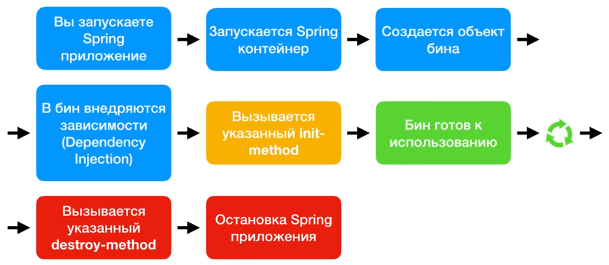

# Spring и Spring Boot

[← Оглавление](README.md) · Hibernate и Spring Data — [hibernate.md](hibernate.md) · Kotlin + Spring — [kotlin.md](kotlin.md#kotlin-и-spring--jpa--подводные-камни)

## 1. Идея Spring: IoC и DI

**Коротко:** **IoC (инверсия управления)** — объекты не создают свои зависимости сами, а получают их извне; созданием и связыванием управляет контейнер. **DI (внедрение зависимостей)** — способ реализовать IoC: контейнер передаёт зависимость через конструктор, сеттер или поле. Плюсы — слабая связанность, легко подменить реализацию в тестах, конфигурация в одном месте.

Вокруг ядра — экосистема: Spring MVC/WebFlux (веб), Data (доступ к данным), Security, Kafka, Cloud, Batch и т. д. **Spring Boot** — надстройка: автоконфигурация, стартеры, встроенный сервер, единая конфигурация, Actuator.

## 2. Бин и контейнер

- **Бин** — объект, которым управляет Spring-контейнер: создаёт, внедряет зависимости, вызывает методы жизненного цикла, при необходимости оборачивает в прокси.
- **`BeanFactory`** — базовый контейнер: создание бинов и DI, ленивое создание.
- **`ApplicationContext`** — расширение `BeanFactory`: события (`ApplicationEvent`), интернационализация, загрузка ресурсов, профили и `Environment`, автоматическая регистрация `BeanPostProcessor`, по умолчанию **создаёт синглтоны сразу при старте** (ошибки конфигурации видны сразу). На практике используют только его.
- Реализации: `AnnotationConfigApplicationContext`, в Boot — `AnnotationConfigServletWebServerApplicationContext` (MVC) и реактивный вариант для WebFlux. XML-варианты (`ClassPathXmlApplicationContext`) — наследие. `XmlBeanFactory` давно удалён.
- **`BeanDefinition`** — описание бина (класс, scope, зависимости, init/destroy-методы, lazy, primary). Контейнер сначала собирает все определения, потом по ним создаёт объекты.

### Способы объявить бин

1. **Аннотации-стереотипы на классе** + сканирование: `@Component`, `@Service`, `@Repository`, `@Controller`/`@RestController`, `@Configuration`.
2. **`@Bean`-метод** в `@Configuration`-классе — для классов из чужих библиотек и когда нужна логика создания.
3. XML (`<bean id=".." class="..">`) — наследие.
4. Программно: `registerBean(...)`, `BeanDefinitionRegistryPostProcessor`, функциональная регистрация (`BeanRegistrar` в Spring Framework 7).

**`@Component` vs `@Bean`:** `@Component` вешается на **свой класс**, бин находит сканирование. `@Bean` — на **метод**, который возвращает объект; так регистрируют классы, которые нельзя пометить аннотацией (из библиотек), или когда создание зависит от условий.

**`@Configuration` vs `@Component` с `@Bean`-методами:** класс `@Configuration` (по умолчанию `proxyBeanMethods = true`) оборачивается CGLIB-прокси, и вызов одного `@Bean`-метода из другого вернёт **тот же синглтон** из контекста. В `@Component` («lite mode») такой вызов — обычный вызов метода, создастся **новый объект**.

### Стереотипы

| Аннотация | Что добавляет кроме регистрации бина |
|---|---|
| `@Component` | ничего — базовая |
| `@Service` | ничего (семантика: бизнес-логика) |
| `@Repository` | **трансляция исключений**: исключения JDBC/JPA превращаются в иерархию Spring `DataAccessException` (через `PersistenceExceptionTranslationPostProcessor`) |
| `@Controller` | класс сканируется на `@RequestMapping` как веб-обработчик; методы по умолчанию возвращают имя представления (view) |
| `@RestController` | **`@Controller` + `@ResponseBody`**: результат методов сериализуется в тело ответа (JSON) |
| `@Configuration` | CGLIB-прокси для `@Bean`-методов (см. выше) |

**Можно ли заменить `@RestController` на `@Component`?** Нет. С Spring 6 обработчиками запросов считаются только бины с `@Controller` на уровне класса (раньше хватало `@RequestMapping` на классе). С `@Component` методы не станут эндпоинтами. Плюс пропадёт `@ResponseBody`.

## 3. Внедрение зависимостей

```java
@Service
@RequiredArgsConstructor                     // Lombok сгенерирует конструктор для final-полей
public class PaymentService {
    private final PaymentRepository repository;
    private final FraudClient fraudClient;
}
```

| Способ | Плюсы | Минусы |
|---|---|---|
| **Конструктор** (рекомендуемый) | зависимости `final` (неизменяемы, безопасная публикация); объект нельзя создать без них; видно, когда зависимостей слишком много (сигнал нарушить SRP); легко тестировать без Spring (`new Service(mock)`); циклы видны сразу при старте | — |
| Сеттер | для **необязательных** зависимостей и переконфигурации | объект может быть в неполном состоянии |
| Поле (`@Autowired private`) | коротко | нельзя `final`; зависимость скрыта; в тестах нужен Spring или рефлексия (`@InjectMocks`); легко незаметно набрать 15 зависимостей |

- С Spring 4.3 при **единственном** конструкторе `@Autowired` писать не нужно.
- Скорость — не довод: рефлексия используется при создании бина один раз на старте в любом способе.
- Если бина нужного типа нет, приложение **упадёт при старте** с `NoSuchBeanDefinitionException` при любом способе внедрения (и через Lombok-конструктор тоже). Для необязательных — `Optional<T>`, `ObjectProvider<T>`, `@Autowired(required = false)`.
- `@RequiredArgsConstructor` — аннотация **Lombok**, не Spring.

### Несколько бинов одного типа

- `@Primary` — бин по умолчанию.
- `@Qualifier("smsSender")` — явно указать имя.
- Внедрить все: `List<NotificationSender>` (в порядке `@Order`) или `Map<String, NotificationSender>` (ключ — имя бина). Основа паттернов Strategy и Chain of Responsibility на Spring — см. [patterns.md](patterns.md).

### Циклические зависимости

A зависит от B, B от A. Через конструкторы такой цикл не разрешить — ошибка `BeanCurrentlyInCreationException`. С **Spring Boot 2.6 циклы запрещены по умолчанию** и для полей/сеттеров (`spring.main.allow-circular-references=false`). Правильное решение — пересмотреть дизайн (вынести общее в третий бин, события). Костыли — `@Lazy` на параметре (внедряется ленивый прокси), `ObjectProvider`.

## 4. Scope бинов

| Scope | Экземпляр | Применение |
|---|---|---|
| **singleton** (по умолчанию) | один на контекст | stateless-сервисы — почти все бины |
| **prototype** | новый при каждом запросе бина у контейнера | stateful-объекты |
| request | один на HTTP-запрос | данные текущего запроса |
| session | один на HTTP-сессию | — |
| application | один на `ServletContext` | — |
| websocket | один на WebSocket-сессию | — |

(`global-session` был для портлетов и удалён в Spring 5.)

- **Синглтон-бин используют одновременно все потоки** — он не должен хранить состояние запроса в полях.
- Для `prototype` Spring **не вызывает destroy-методы** — контейнер не отслеживает созданные экземпляры.
- **Prototype внутри singleton:** зависимость внедряется **один раз** при создании синглтона, и он будет всё время работать с одним и тем же экземпляром prototype. Чтобы получать новый каждый раз — `ObjectProvider<T>.getObject()`, `@Lookup`-метод или scoped proxy (`@Scope(value = "prototype", proxyMode = ScopedProxyMode.TARGET_CLASS)`). Так же внедряют request-бины в синглтоны — через прокси.

## 5. Жизненный цикл бина



1. Прочитаны все `BeanDefinition`. Отработали **`BeanFactoryPostProcessor`** — могут изменить определения (например, подставить `${...}` из настроек — `PropertySourcesPlaceholderConfigurer`).
2. **Создание объекта** (вызов конструктора — здесь же внедряются зависимости конструктора).
3. **Внедрение** зависимостей через сеттеры и поля.
4. Вызов `*Aware`-методов (`BeanNameAware`, `ApplicationContextAware`…).
5. **`BeanPostProcessor.postProcessBeforeInitialization`**.
6. Инициализация: **`@PostConstruct`** → `InitializingBean.afterPropertiesSet()` → `init-method` (`@Bean(initMethod = ...)`).
7. **`BeanPostProcessor.postProcessAfterInitialization`** — **здесь создаются прокси** (AOP, `@Transactional`, `@Async`, `@Cacheable`): вместо исходного объекта в контекст кладётся обёртка.
8. Бин готов к работе.
9. При закрытии контекста: **`@PreDestroy`** → `DisposableBean.destroy()` → `destroy-method`.

- **`BeanPostProcessor`** — точка расширения: обрабатывает **каждый** бин после создания; может изменить его или подменить прокси. Так работают `@Autowired` (`AutowiredAnnotationBeanPostProcessor`), `@Transactional`, `@Async`.
- **`BeanFactoryPostProcessor`** работает **до создания** бинов, с их определениями.
- В `@PostConstruct` прокси ещё нет: вызвать оттуда свой `@Transactional`-метод — транзакции не будет. Для логики «после полного старта» — `ApplicationRunner` или событие `ApplicationReadyEvent`.

## 6. AOP и прокси

**Коротко:** AOP выносит сквозную функциональность (транзакции, логирование, безопасность, метрики, кэш) из бизнес-кода. Spring реализует AOP через **прокси**: в контекст кладётся объект-обёртка, который перехватывает вызовы методов, выполняет дополнительную логику и вызывает настоящий метод.

Термины: **aspect** (класс со сквозной логикой), **advice** (что делать: `@Before`, `@After`, `@AfterReturning`, `@AfterThrowing`, `@Around`), **pointcut** (где: выражение, выбирающее методы), **join point** (конкретный вызов метода).

```java
@Aspect
@Component
class TimingAspect {
    @Around("@annotation(Timed)")
    Object measure(ProceedingJoinPoint pjp) throws Throwable {
        long start = System.nanoTime();
        try {
            return pjp.proceed();                 // вызвать настоящий метод
        } finally {
            log.info("{} занял {} мс", pjp.getSignature(), (System.nanoTime() - start) / 1_000_000);
        }
    }
}
```

### JDK Dynamic Proxy vs CGLIB

| | JDK Dynamic Proxy | CGLIB |
|---|---|---|
| Как | реализует **интерфейсы** целевого класса | создаёт **наследника** целевого класса |
| Требования | класс реализует интерфейс; внедрять можно только по интерфейсу | класс и методы не `final`; нужен доступный конструктор |
| Что не перехватит | методы вне интерфейса | `final`, `private`, `static` методы |

- **Spring Boot 2.0+ по умолчанию использует CGLIB** (`spring.aop.proxy-target-class=true`) — даже для классов с интерфейсами. В «чистом» Spring Framework без Boot по умолчанию — JDK-прокси, если есть интерфейс.
- Для Kotlin это причина плагина `kotlin-spring` (классы по умолчанию `final`).

### Главное ограничение — self-invocation

Прокси перехватывает только вызовы **снаружи**, через ссылку на прокси. Вызов `this.method()` внутри того же бина идёт напрямую в объект, **мимо прокси** — аннотации `@Transactional`, `@Async`, `@Cacheable`, `@Retryable` на вызываемом методе не сработают.

## 7. `@Transactional`

**Коротко:** декларативные транзакции через AOP-прокси. Прокси перед вызовом метода открывает транзакцию (или присоединяется к существующей), после — коммитит, при исключении — откатывает.

### Что важно знать

- **Откат по умолчанию только при `RuntimeException` и `Error`.** На проверяемых исключениях (`Exception`, `IOException`) транзакция **коммитится**! Менять: `@Transactional(rollbackFor = Exception.class)`. (В Kotlin все исключения «непроверяемые» для компилятора, но для Spring `IOException` остаётся checked — правило то же.)
- Если исключение поймано внутри метода и не выброшено наружу — прокси о нём не узнает, будет коммит.
- **Где работает:** на `public` методах; с Spring 6 при CGLIB-прокси — ещё на `protected` и package-private. **На `private` — никогда** (прокси не может их переопределить). Аннотация на private-методе просто игнорируется — без ошибки.
- **Self-invocation** не работает (см. выше).
- `readOnly = true` — подсказка: Hibernate не делает dirty checking и flush (быстрее, меньше памяти), драйвер может отправить запрос на реплику. Для методов только чтения — хорошая практика. Для простого единичного `select` транзакция не обязательна, но для нескольких связанных чтений даёт согласованность в рамках одного соединения.
- `timeout`, `isolation` — таймаут и уровень изоляции ([databases.md](databases.md#3-уровни-изоляции)).
- Ставить на уровне **сервиса** (единица бизнес-операции), не на контроллер и не на каждый метод репозитория.
- **Не делать внешних вызовов** (HTTP, Kafka, долгие вычисления) внутри транзакции — соединение с БД занято всё это время.

### Propagation — что делать, если транзакция уже есть

| Propagation | Есть транзакция | Нет транзакции |
|---|---|---|
| **REQUIRED** (по умолчанию) | присоединиться | создать новую |
| **REQUIRES_NEW** | **приостановить** текущую, создать новую независимую | создать новую |
| NESTED | savepoint внутри текущей: можно откатить только вложенную часть (JDBC, не JPA-провайдеры по умолчанию) | создать новую |
| SUPPORTS | присоединиться | выполнить без транзакции |
| NOT_SUPPORTED | приостановить, выполнить без транзакции | без транзакции |
| MANDATORY | присоединиться | **исключение** |
| NEVER | **исключение** | без транзакции |

- **`REQUIRES_NEW`** — например, записать аудит/журнал попытки, который должен сохраниться, даже если основная транзакция откатится. Берёт **второе соединение** из пула — при массовом использовании пул может закончиться (deadlock на пуле).
- **`UnexpectedRollbackException`** — классика: внешний метод (REQUIRED) вызывает внутренний (REQUIRED, тот же транзакционный контекст), внутренний бросает RuntimeException → транзакция помечена rollback-only; внешний метод ловит исключение и пытается закоммитить → Spring бросает `UnexpectedRollbackException`. Если нужна независимость — `REQUIRES_NEW` или не ловить.

### Задача: создастся ли новая транзакция?

```java
@Service
public class OrderService {
    @Transactional
    public void createOrder() {
        save();
        sendEvent();          // вызов внутри того же класса
    }

    @Transactional(propagation = Propagation.REQUIRES_NEW)
    public void sendEvent() { ... }
}
```

**Нет.** `sendEvent()` вызывается через `this`, мимо прокси, и выполняется в транзакции `createOrder()`. Варианты решения:
1. **Вынести метод в другой бин** — самое чистое решение (отдельный сервис или фасад, который вызывает оба метода).
2. **`TransactionTemplate`** — программное управление транзакцией:

```java
transactionTemplate.setPropagationBehavior(TransactionDefinition.PROPAGATION_REQUIRES_NEW);
transactionTemplate.executeWithoutResult(status -> eventRepository.save(event));
```

3. **Self-injection** — внедрить в бин ссылку на собственный прокси и вызывать через неё. Из-за запрета циклических ссылок (Boot 2.6+) — через `@Lazy` или `ObjectProvider<OrderService>`. Работает, но выглядит как костыль.
4. Режим AspectJ (`mode = AdviceMode.ASPECTJ`, weaving при компиляции или загрузке) — перехватывает и внутренние вызовы. Редко используется.

### Транзакции и события

`@TransactionalEventListener(phase = AFTER_COMMIT)` — выполнить обработчик события только **после успешного коммита** (например, отправить уведомление). Не гарантирует доставку при падении после коммита — для гарантии нужен [outbox](microservices.md#transactional-outbox).

## 8. Spring Boot

### Автоконфигурация

- `@SpringBootApplication` = `@SpringBootConfiguration` (это `@Configuration`) + `@EnableAutoConfiguration` + `@ComponentScan` (пакет класса и вложенные).
- Автоконфигурации — обычные `@AutoConfiguration`-классы, перечисленные в `META-INF/spring/org.springframework.boot.autoconfigure.AutoConfiguration.imports` внутри jar-ов (до Boot 2.7 — в `spring.factories`).
- Каждая включается по **условиям**: `@ConditionalOnClass` (есть класс на classpath — например, драйвер PostgreSQL), `@ConditionalOnMissingBean` (вы не объявили свой бин — тогда создаём по умолчанию), `@ConditionalOnProperty`, `@ConditionalOnWebApplication`.
- Отсюда принцип: **объявите свой бин — автоконфигурация отступит.**
- Посмотреть, что сработало и почему: запуск с `--debug` (condition evaluation report) или Actuator `/actuator/conditions`.
- **Стартер** (`spring-boot-starter-web`, `-data-jpa`) — набор зависимостей для функциональности; автоконфигурация лежит отдельно.
- Свой стартер: модуль с `@AutoConfiguration`-классом + файл `.imports` + `@ConfigurationProperties`.

### Конфигурация

- `application.yml` / `.properties`, профили: `application-prod.yml`, включаются `spring.profiles.active=prod`. `@Profile("dev")` на бине — бин создаётся только в этом профиле. Зачем: разная конфигурация для окружений (локально, тест, прод), заглушки внешних систем в dev.
- Приоритет (упрощённо, сверху важнее): аргументы командной строки → переменные окружения → `application-{profile}.yml` → `application.yml` → значения по умолчанию в коде. Поэтому в Kubernetes настройки переопределяют через переменные окружения.
- **`@ConfigurationProperties(prefix = "payment")`** — типобезопасный класс настроек (можно record), с валидацией `@Validated`. Предпочтительнее разрозненных `@Value("${...}")`.
- Секреты — не в git: переменные окружения, Vault, Kubernetes Secrets.

### Actuator и наблюдаемость

- `/actuator/health` (liveness и readiness для Kubernetes — `/actuator/health/liveness`, `/readiness`), `/metrics`, `/prometheus`, `/info`, `/loggers` (менять уровень логов на лету), `/threaddump`, `/heapdump`.
- Метрики — **Micrometer** → Prometheus → Grafana. Трассировка — Micrometer Tracing / OpenTelemetry. Подробнее — [microservices.md](microservices.md#наблюдаемость).
- Наружу открывать только нужные эндпоинты; `heapdump` и `env` содержат секреты.

### Версии (актуально на конец 2026)

- **Spring Boot 3.x** (с 2022): Java 17+, переход с `javax.*` на **`jakarta.*`**, Spring Framework 6, Hibernate 6, нативные образы GraalVM, Micrometer Observation, виртуальные потоки (3.2+, `spring.threads.virtual.enabled`), `RestClient` (3.2), `JdbcClient` (3.2), Docker Compose и Testcontainers в dev-режиме.
- **Spring Boot 4.0** (ноябрь 2025): Spring Framework 7, Java 17+ (рекомендуется 21/25), Jakarta EE 11, null-безопасность API через **JSpecify**, встроенное версионирование API, декларативные HTTP-клиенты (`@HttpExchange`) удобнее подключать, встроенные `@Retryable` и `@ConcurrencyLimit` в ядре Spring, модульные автоконфигурации, Jackson 3, Hibernate 7.
- Миграция 2 → 3 (частая тема, в резюме — «миграция на Spring Boot 3»): `javax` → `jakarta`, Java 17, Spring Security 6 (нет `WebSecurityConfigurerAdapter`, только бин `SecurityFilterChain`), изменения в свойствах (помогает `spring-boot-properties-migrator`), Hibernate 6 (изменения в типах и генерации id), Sleuth → Micrometer Tracing, обновление библиотек. Инструмент — OpenRewrite.

## 9. Spring MVC: как обрабатывается запрос

1. Запрос приходит во встроенный сервер (**Tomcat** по умолчанию; Jetty, Undertow — альтернативы). Сервер берёт поток из своего пула (или виртуальный поток).
2. Проходит цепочку **фильтров** (`Filter` — уровень сервлетов: Spring Security, логирование, CORS).
3. Попадает в **`DispatcherServlet`** — единую точку входа (паттерн Front Controller).
4. `HandlerMapping` находит метод контроллера по URL и HTTP-методу.
5. Вызываются **`HandlerInterceptor.preHandle`** (уровень Spring MVC: есть доступ к найденному обработчику).
6. `HandlerAdapter` вызывает метод контроллера: аргументы разбираются (`@PathVariable`, `@RequestParam`, `@RequestBody` через `HttpMessageConverter` — Jackson превращает JSON в объект), валидируются (`@Valid`).
7. Результат с `@ResponseBody` сериализуется обратно через `HttpMessageConverter` в JSON.
8. Исключения обрабатывает `HandlerExceptionResolver` → **`@ControllerAdvice` / `@ExceptionHandler`**.

**Кто вызывает методы контроллера?** `DispatcherServlet` через `HandlerAdapter`.

**Фильтр vs интерсептор vs аспект:** фильтр — до Spring MVC, видит сырые запрос и ответ, работает для всего (и статики); интерсептор — внутри Spring MVC, знает, какой контроллер вызывается; аспект — на уровне любых методов бинов, не только веба.

### Обработка ошибок и валидация

```java
@RestControllerAdvice
class ApiExceptionHandler {
    @ExceptionHandler(EntityNotFoundException.class)
    ProblemDetail notFound(EntityNotFoundException e) {
        return ProblemDetail.forStatusAndDetail(HttpStatus.NOT_FOUND, e.getMessage());   // RFC 9457 (Spring 6+)
    }

    @ExceptionHandler(MethodArgumentNotValidException.class)
    ProblemDetail invalid(MethodArgumentNotValidException e) { ... }
}

record CreatePaymentRequest(@NotNull @Positive BigDecimal amount, @NotBlank String account) {}

@PostMapping("/payments")
ResponseEntity<PaymentDto> create(@Valid @RequestBody CreatePaymentRequest request) { ... }
```

### HTTP-клиенты

- `RestTemplate` — старый синхронный, в режиме поддержки.
- **`RestClient`** (Spring 6.1) — новый синхронный с fluent API. Отлично сочетается с виртуальными потоками.
- **`WebClient`** — реактивный, неблокирующий (WebFlux).
- **HTTP interface** (`@HttpExchange`) — декларативный клиент как интерфейс, замена Feign.
- Всегда задавать **таймауты** (connect и read) — без них зависший внешний сервис съест все потоки.

## 10. WebFlux

- Реактивный стек: **Project Reactor** (`Mono<T>` — 0..1 элемент, `Flux<T>` — 0..N), по умолчанию сервер **Netty**, неблокирующий ввод-вывод и маленький пул event-loop потоков.
- Плюс — держит огромное число одновременных соединений малым числом потоков; есть **backpressure** (потребитель регулирует скорость).
- Минусы — сложнее код и отладка (стектрейсы), вся цепочка обязана быть неблокирующей: JDBC нельзя (нужен R2DBC или вынос на `Schedulers.boundedElastic()`), `ThreadLocal` не работает «как обычно» (контекст — Reactor Context).
- **Главная ошибка** — блокирующий вызов в event-loop потоке: встаёт весь сервис. Найти помогает BlockHound.
- В Kotlin обычно пишут на корутинах поверх WebFlux: `suspend`-контроллеры, `Flow`, `awaitSingle()`.
- Когда выбирать сейчас: стриминг, очень много одновременных долгих соединений, уже реактивная экосистема. Для обычного CRUD-сервиса в 2026 году проще Spring MVC + виртуальные потоки.

## 11. Spring Security (основы)

- Работает как цепочка **фильтров** (`SecurityFilterChain`) перед `DispatcherServlet`.
- **Аутентификация** — кто ты (логин/пароль, JWT, сертификат) → `Authentication` в `SecurityContextHolder` (по умолчанию `ThreadLocal`). **Авторизация** — что тебе можно (`authorizeHttpRequests`, `@PreAuthorize("hasRole('ADMIN')")`).
- Spring Security 6: конфигурация только через бин `SecurityFilterChain` и лямбда-DSL, `WebSecurityConfigurerAdapter` удалён.

```java
@Bean
SecurityFilterChain api(HttpSecurity http) throws Exception {
    return http
            .csrf(csrf -> csrf.disable())                       // для stateless REST API с токенами
            .sessionManagement(s -> s.sessionCreationPolicy(SessionCreationPolicy.STATELESS))
            .authorizeHttpRequests(auth -> auth
                    .requestMatchers("/actuator/health/**").permitAll()
                    .anyRequest().authenticated())
            .oauth2ResourceServer(o -> o.jwt(Customizer.withDefaults()))   // проверка JWT
            .build();
}
```

- Сервис как **Resource Server** проверяет JWT от провайдера (Keycloak и т. п.) по публичному ключу (JWKS). Подробнее про JWT и OAuth2 — [web.md](web.md#аутентификация-jwt-oauth2).
- Пароли — только хэш с солью (`BCryptPasswordEncoder`, Argon2), никогда не в открытом виде.
- CSRF отключают для stateless API с токенами в заголовке; для cookie-сессий — оставляют.

## 12. Прочее, о чём спрашивают

- **`@Async`** — выполнить метод в другом потоке (через прокси — та же проблема self-invocation). Включается `@EnableAsync`; без своего executor в Boot используется `ThreadPoolTaskExecutor` из автоконфигурации. Исключения из `void`-методов теряются без `AsyncUncaughtExceptionHandler`.
- **`@Scheduled`** — задачи по расписанию (`fixedRate`, `fixedDelay`, `cron`). На нескольких инстансах сработает **на каждом** — для единственного запуска нужна распределённая блокировка (**ShedLock**).
- **`@Cacheable`** — кэширование результата метода (Caffeine локально, Redis распределённо). Тоже через прокси.
- **События:** `ApplicationEventPublisher.publishEvent(...)` + `@EventListener` — слабая связанность внутри приложения.
- **`@Value` vs `@ConfigurationProperties`** — одно значение против типобезопасной группы настроек.
- **Чем Spring отличается от Spring Boot?** Spring — фреймворк (DI, AOP, MVC…), Boot — готовая сборка поверх него: автоконфигурация, стартеры, встроенный сервер, Actuator, запуск `java -jar`.
- **Как Spring Boot запускает Tomcat?** Встроенный Tomcat — обычная библиотека; автоконфигурация создаёт `TomcatServletWebServerFactory`, и контекст запускает сервер при старте.
- **Тестирование:** `@SpringBootTest` (весь контекст), срезы `@WebMvcTest` (только веб-слой), `@DataJpaTest` (только JPA), `@MockitoBean` (Spring 6.2+, замена `@MockBean`) — см. [testing.md](testing.md).
